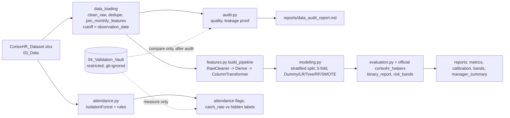

# Architecture (Phase 1)

Rules the design enforces: nothing learned from the test rows (pipeline fitted on training rows only), no post-outcome columns (`config.FORBIDDEN_AS_INPUT`), monthly features only from complete months before the snapshot, vault files never used as inputs.
