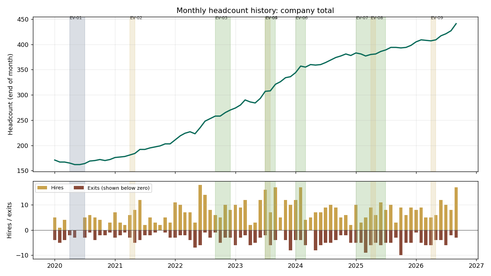

# Day 16 - Forecast the future: headcount with uncertainty

Generated 2026-11-20 by `scripts/build_docs.py` from `outputs/forecast/`. Run `python scripts/run_forecast.py` first to refresh the files.

## 1. What the history looks like (step 1)

* **Trend:** headcount grew from 171 (2020-01) to 441 (2026-09), about 3.8 people per month on average. Year-end growth: 2021: +18.0%, 2022: +33.0%, 2023: +24.4%, 2024: +12.5%, 2025: +5.3%, 2026: +10.8%.
* **Seasons:** hires peak in month 6 and are lowest in month 5; exits peak in month 5 and are lowest in month 11 (average per calendar month below).
* **Unusual months** (net change far from normal, robust z-score >= 3) and the events that overlap them:

| month | net_change | robust_z | events |
|---|---|---|---|
| 2022-06 | 12.0 | 3.0 | no recorded event |
| 2022-07 | 13.0 | 3.4 | no recorded event |
| 2023-07 | 14.0 | 3.7 | Hybrid work policy introduced, Engineering hiring drive |
| 2023-09 | 13.0 | 3.4 | no recorded event |
| 2024-02 | 13.0 | 3.4 | Sales expansion hiring drive |
| 2026-09 | 14.0 | 3.7 | no recorded event |

Average hires, exits and net change per calendar month:

| month | hires | exits | net_change |
|---|---|---|---|
| 1 | 9.0 | 3.71 | 6.0 |
| 2 | 7.43 | 3.71 | 3.71 |
| 3 | 5.57 | 4.29 | 1.29 |
| 4 | 4.86 | 3.86 | 1.0 |
| 5 | 4.71 | 5.29 | -0.57 |
| 6 | 10.29 | 4.14 | 6.14 |
| 7 | 9.14 | 3.43 | 5.71 |
| 8 | 7.71 | 3.43 | 4.29 |
| 9 | 8.57 | 2.86 | 5.71 |
| 10 | 5.0 | 3.17 | 1.83 |
| 11 | 6.5 | 2.83 | 3.67 |
| 12 | 5.83 | 4.17 | 1.67 |

## 2. Models (steps 2-4)
* **Seasonal baseline** ("same as last year plus trend"): value 12 months earlier + the latest year-on-year change (headcount); same-month average of the last 3 years (exits).
* **Better model:** statsmodels SARIMAX regression with AR(1) errors on the monthly net change, with workforce events (hiring freeze, hiring boost, policy change) and yearly seasonality as regressors. **Status in the saved run: run.**
* **Workforce events:** Past events enter the improved model as 0/1 regressors (hiring freeze, hiring boost, policy change); a future what-if event can be supplied as a scenario. The baseline ignores events on purpose: it is the benchmark. Future events known in the data: none in workforce_events.csv after 2026-04.

## 3. Backtest (step 5): hide the last 6 months, forecast them, measure the error
| metric | model | scope | n | mae | mape_pct | bias | coverage_80 |
|---|---|---|---|---|---|---|---|
| headcount_end | baseline | holdout_last_6_months | 6 | 4.333 | 1.008 | 2.0 | 1.0 |
| headcount_end | baseline | rolling_origin | 162 | 9.809 | 2.556 | -5.364 | 0.679 |
| headcount_end | improved | holdout_last_6_months | 6 | 3.958 | 0.936 | -0.928 | 0.833 |
| headcount_end | improved | rolling_origin | 162 | 7.153 | 1.859 | -6.082 | 0.753 |
| exits | baseline | holdout_last_6_months | 6 | 1.833 | 55.093 | -0.5 | 1.0 |
| exits | baseline | rolling_origin | 162 | 1.965 | 47.327 | 1.047 | 0.852 |
| exits | improved | holdout_last_6_months | 6 | 1.314 | 30.412 | 0.411 | 0.833 |
| exits | improved | rolling_origin | 162 | 2.041 | 43.673 | 1.386 | 0.63 |
| exits | improved | rolling_origin_raw_same_rows | 114 | nan | nan | nan | 0.658 |
| exits | improved | rolling_origin_calibrated_walk_forward | 114 | nan | nan | nan | 0.895 |
| headcount_end | improved | rolling_origin_raw_same_rows | 150 | nan | nan | nan | 0.747 |
| headcount_end | improved | rolling_origin_calibrated_walk_forward | 150 | nan | nan | nan | 0.813 |

`holdout_last_6_months` is exactly the requested test (2026-04 to 2026-09 hidden). `rolling_origin` repeats it from many past starting points for a steadier picture. `coverage_80` should be near 0.80; the baseline intervals are calibrated on the baseline's own past errors (see `interval_calibration_study.csv`).

## 4. The forecast (step 6)
Company headcount, 80% interval; all columns match `sample_forecast.csv` (`outputs/forecast/forecast_next_6_months.csv`).

| forecast_month | forecast_value | lower_80 | upper_80 |
|---|---|---|---|
| 2026-10-01 | 443.8 | 437.0 | 450.6 |
| 2026-11-01 | 446.3 | 436.5 | 456.1 |
| 2026-12-01 | 450.1 | 438.0 | 462.2 |
| 2027-01-01 | 454.6 | 440.5 | 468.6 |
| 2027-02-01 | 458.0 | 442.2 | 473.7 |
| 2027-03-01 | 459.2 | 442.0 | 476.5 |

Headcount moves from 441 to 459 (+4.1%), with about 29 exits in six months. Model: cortexhr-forecast-1.0.0, trained through 2026-09.

## 5. Think for yourself: which month would you trust least? Why?
| forecast_month | interval_width | relative_width_pct |
|---|---|---|
| 2026-10-01 | 13.6 | 3.06 |
| 2026-11-01 | 19.6 | 4.39 |
| 2026-12-01 | 24.2 | 5.38 |
| 2027-01-01 | 28.1 | 6.18 |
| 2027-02-01 | 31.5 | 6.88 |
| 2027-03-01 | 34.5 | 7.51 |

**2027-03**: its 80% interval is the widest: uncertainty about monthly hires and exits accumulates month after month. The range widens every month, so the sixth month is the least certain.

## 6. Limits
* A single hiring freeze (2020) is the only example the model has of that effect, so its size is uncertain.
* Intervals ignore parameter uncertainty and assume no new unmodelled event (e.g. a sudden layoff).
* Department series are small; their intervals are wide relative to the level.
